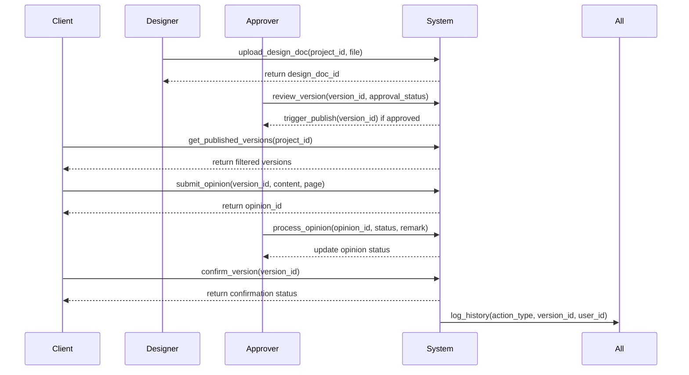

# 设计稿送审与客户确认工具：完整设计文档（修订版）

## 一、业务理解
系统需支持多角色协作的版本化设计稿管理流程，核心业务流为：
设计师上传设计稿→负责人审核→发布→客户确认/提意见→版本迭代
关键约束：
- 版本化管理（每设计稿可多版本）
- 客户视角隔离（仅可见已发布版本）
- 意见与确认绑定最新版本
- 严格权限分离（确认人特权 vs 通用客户）

## 二、规则与未知
### 已知规则
- F01-F10（见事实卡）
- 版本状态：草稿/审核中/已发布/已废弃
- 意见状态：待处理/已处理/已驳回
- 确认状态：未确认/已确认/已撤回
- 历史记录不可修改

### 待确认问题
- Q01：客户确认后的新修改申请如何触发新版本？
- Q02：负责人处理意见是否需要记录处理方式？
- Q03：是否允许客户对已发布但未确认版本提意见？
- Q04：设计稿上传是否需要版本命名规范？

## 三、关键状态及权限矩阵
| 角色           | 权限说明                                                                 |
|----------------|--------------------------------------------------------------------------|
| 设计师         | 上传设计稿，编辑草稿，查看所有版本（含未发布）                          |
| 负责人         | 审核/发布版本，处理客户意见，查看所有项目数据                           |
| 客户确认人     | 查看已发布版本，对最新版本进行确认操作                                  |
| 其他客户       | 查看已发布版本，对最新版本提意见，无法确认                              |
| 所有角色       | 查看历史记录（含未发布版本），但无法修改已发布内容                     |

## 四、数据模型与接口设计
### 核心数据模型
```mermaid
erDiagram
    PROJECT -->|< DESIGN_DOCUMENT
    DESIGN_DOCUMENT -->|< VERSION
    VERSION -->|< OPINION
    VERSION -->|< CONFIRMATION
    VERSION -->|< HISTORY
    
    PROJECT {
        int id
        string name
        int client_confirmer_id
        datetime created_at
    }
    
    DESIGN_DOCUMENT {
        int id
        string title
        string file_path
        int project_id
    }
    
    VERSION {
        int id
        string version_number
        string status (draft/review/published/archived)
        int design_doc_id
        datetime created_at
    }
    
    OPINION {
        int id
        string content
        int page_number
        int version_id
        int user_id
        datetime created_at
        string status (pending/processed/rejected)
    }
    
    CONFIRMATION {
        int id
        int version_id
        int user_id
        datetime confirmed_at
        string confirmation_type (initial/revision)
    }
    
    HISTORY {
        int id
        string action_type
        int version_id
        int user_id
        datetime timestamp
    }
```

### 核心接口清单


## 五、主要实施任务
1. **版本控制模块**
   - 实现多层级版本树结构
   - 自动同步设计稿与版本关系
   - 状态机管理（草稿→审核中→已发布→已废弃）

2. **权限控制模块**
   - 基于RBAC的细粒度权限
   - 客户确认人特殊权限校验（仅允许确认最新版本）
   - 版本状态与操作权限关联（仅允许对已发布版本进行意见提交和确认）

3. **意见处理流程**
   - 意见绑定版本与页面（version_id必填）
   - 处理状态追踪（待处理→已处理→已驳回）
   - 处理记录与原始意见关联

4. **发布机制**
   - 审核通过自动触发发布（单接口）
   - 旧版本只读锁定（状态标记为archived）
   - 新版本发布时触发历史记录（不归档，仅保留历史记录）

5. **数据隔离**
   - 项目级数据隔离（project_id过滤）
   - 客户视角过滤（仅显示已发布版本，通过version.status=published）
   - 历史数据完整保留（不进行归档操作）

## 六、可验证验收场景
### 场景1：版本发布流程
- 前置条件：设计师上传v1.0设计稿
- 操作：负责人审核通过
- 预期结果：
  - 系统自动发布v1.0
  - 客户可查看v1.0
  - v1.0变为只读状态（状态标记为archived）

### 场景2：意见处理流程
- 前置条件：客户对v1.0提交意见
- 操作：负责人处理意见
- 预期结果：
  - 系统记录处理状态
  - 客户无法确认直到意见处理完成
  - 历史记录包含处理过程（不归档）

### 场景3：版本迭代验证
- 前置条件：v1.0已发布并确认
- 操作：设计师上传v2.0
- 预期结果：
  - 客户仅可见v2.0（通过version.status=published过滤）
  - v1.0确认状态不继承（新版本独立状态）
  - v1.0意见保留但不可操作（仅允许查看）

## 七、产品与技术自检
### 产品合规性
- ✅ 全部事实卡规则已覆盖（F01-F10）
- ✅ 未引入未确认功能（如通知、云存储、归档、版本对比）
- ✅ 权限矩阵符合技术边界要求（区分客户确认人与其他客户）

### 技术可行性
- ✅ 版本状态机设计合理（draft→review→published→archived）
- ✅ 数据隔离方案可行（project_id+version.status=published）
- ✅ 接口设计符合RESTful规范（所有操作绑定version_id）

### 风险点
- 历史数据量可能影响查询性能（建议分页+缓存）
- 多版本并发处理需考虑锁机制
- 客户确认人权限需严格校验（建议双重验证）

## 八、候选建议（非本期范围）
1. 增加版本对比功能（禁止项）
2. 实现批量意见处理
3. 增加设计稿预览功能
4. 支持多格式文件（如PSD） [end of text]
